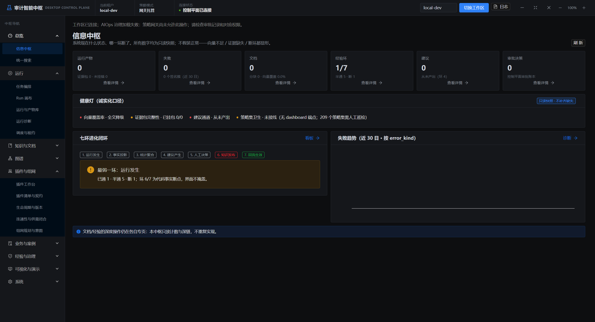

# 2026-10-30 部署失败排查

## 已确认的原因

用户的 Debug3 合成工作区记录显示：数据库初始化、迁移、种子数据、插件注册和图谱索引均完成，API 的健康检查返回 200；随后进程退出，没有进入工作台。不是把初始化或数据库连通失败当作结论。

直接解包已分发的桌面归档后发现：

| 产物 | 桌面主程序 SHA256 | 包含启动窗口交接修复 |
|---|---|---|
| `.2` 包内 | `a8c9bb073f3db7276766349f80444c5284ecbbe8f22293571eb149c3a7a519e6` | 否 |
| `.3` 包内 | `a8c9bb073f3db7276766349f80444c5284ecbbe8f22293571eb149c3a7a519e6` | 否 |
| `.3` 本次编译输出 | `7c076cbf0717358226909375b69abdfcfb9ab7e89b2583de7784f45d06011210` | 是 |

原打包配置继承开发配置中的 `out/**`，又尝试以外部目录映射加入新输出。最终归档选中了开发目录中的旧文件。版本号更新了，主程序没有更新。因此此前源码测试、后端运行时验证成功，没有证明安装包已包含修复。这是交付验证缺口。

此外，本机普通安装项仍登记为 `.2`；独立 Debug3 启动项确实执行过 `.3`，但同样受旧主程序问题影响。`.2` 和 `.3` 都不能继续按可用安装包分发。

## 修复与验收方式

- 使用独立 Electron 应用目录，只放本次编译输出及运行元数据，隔离开发 `desktop/out`。
- 展开打包配置并禁用配置继承；渲染器依赖已打入 Vite 输出，主进程和 preload 只允许 Electron/Node 内置依赖。
- 先生成解包程序，逐个比较编译文件与 app.asar 的原始字节、版本及主入口。任何缺失或摘要不符都阻止制作安装器。
- 再实际启动解包 EXE，以独立合成配置目录验证工作台在线、保存主界面图像并正常退出，确认专用数据库停止；不是只启动后端。
- 原生验证仅使用本机合成工作区，阻断远端浏览器流量；不调用真实云模型和生产设施。

旧 `.3` 的真实 EXE 已在自动原生验证中复现：进程返回 0，但在工作台渲染前退出，没有截图；测试明确失败，专用数据库已停止。

新候选版本 `0.1.0-debug.20261030.4` 继续属于 Gitee 调试交付，构建门禁必须通过后才输出安装器。Phase 10、异机部署、公网网页版及完整旧工作区恢复不因此标记完成。

## 本轮实测结果

构建源码提交：`6730c6d9cb7b`。最终归档的 **21 个编译文件**与本次输出逐一相同，已拒绝开发依赖回收；其中主程序 SHA256 为 `719ab88fede2d95cc49b772dd1d61a90a6841f4634001490307e43f204de47e9`。

真实解包 EXE 在新的合成工作区中启动，进入在线工作台，稳定等待后保存截图，再经正常退出路径停止后台，进程退出码 0，专用 PostgreSQL 已停止。截图不是网页模拟或源码预览。

安装包大小 184,478,065 字节，SHA256：`07631afd610931ded239fc545a8d7d6b3c79a4f46cf29241ce68980f7af3270e`。安装交互和另一台干净电脑仍需分别验收，不能从本次解包程序启动直接推导全部通过。

本轮检查：桌面 122 项、发行工具 Python 6 项、归档真实 ASAR 检查 4 项、源码编码 7 项、Web 4 项、浏览器上传 3 项通过；根/桌面 TypeScript、全仓 Ruff 和 149 文件 Mypy 通过。此前业务全量 Python 的 2586 passed / 13 skipped 是前轮记录，本轮未重复运行未修改的全部业务套件。

## 启动后仍存在的配置阻断

真实截图与本机接口日志还显示，审计、量化、AIOps、图谱提案和组网证据等读取会返回 409，需要对应的策略授权；工作区初始化目前没有补齐这些页面的可用配置。这与进程启动退出是不同的问题。

例如 `audit.chain.read`、`quant.chain.read`、`aiops.chain.read` 的路由会经过网关，无匹配允许规则时进入 REQUIRE_APPROVAL。当前审批消费闭环仅补齐知识上传，不能把其他能力的审批记录存在当作已经可执行。因此“控制平面已连接”并不代表这些页面已通过功能验收。后续须补受控的初始只读配置及对应审批路径，保持租户、Trace 和策略审计，不使用通配 AUTO 掩盖缺口。
