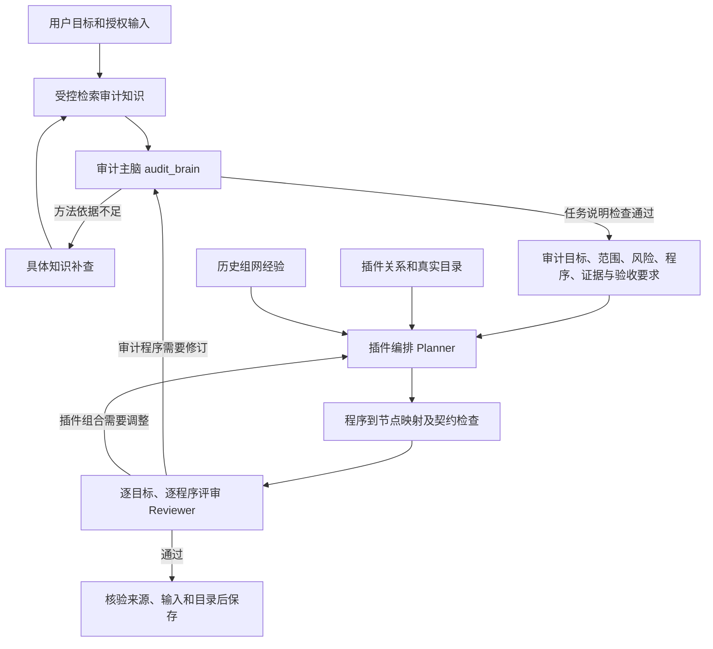

# Phase 10 审计主脑交接层：实现与验收

2026-10-28，用户要求按“审计知识库主脑 → 插件关系及插件库 → 历史组网经验”的主次关系补齐。审计域已接入新流程；整个 Phase 10 保持进行中。

## 当前流程

主脑收到原始请求和知识证据，不接收插件目录或历史运行作为审计方法授权。知识来源引用、原目标摘要及知识快照摘要必须有效；依据尚未补齐时不进入插件关系和经验查询。

新 `AuditTaskBrief` 包含目标、范围、风险假设、审计程序、适用前提和待补查项。每项程序列明用户目标引用、方法、所需证据、验收标准及真实知识引用。主脑不能修改用户目标、预算、工件或权限，不能返回插件连线。

候选的 `procedure_nodes` 将每项程序映射到实际节点；遗漏程序、引用未知节点、加入未对应程序的节点都会被拒绝。Reviewer 绑定任务说明摘要并逐程序评审；知识快照变化或评审要求修改业务程序时，主脑会重新生成说明。若同时提出插件查询，该查询延后至主脑修订通过之后。编译摘要绑定任务说明，旧评审不能批准新的审计程序。

知识上下文仅传一次正文表示及来源身份，完整结构事实仍保留在后台、历史和最终核验中。保持原有 64000 字符模型请求上限，不以扩大预算掩盖重复内容问题。

非审计域保留原协作规划流程。历史通过记录继续保存；没有任务说明的旧审计方案在页面提示重新提交复验。

## 当前会话实际接入验证

继续使用用户指定的当前 Codex 会话，经本机 OpenAI 兼容中继逐次接收并回填响应，没有切换其他模型。

| 项目 | 实际结果 |
|---|---|
| 会话 | `35c4950c-d1ab-440a-8033-2096d7057df2` |
| Trace | `7ab58737-0307-40cc-9966-0364dd673434` |
| 流程 | 首轮主脑阻断 → 定向补查 → 次轮主脑形成两项程序 → 编排 → 逐程序评审通过 |
| 调用顺序 | `audit_brain → audit_brain → planner → reviewer` |
| 轮次 / 模型调用 / 来源查询计数 | 2 / 4 / 7 |
| 审计程序 / 实现节点 / 连线 | 2 / 2 / 1 |
| 持久化事件 | 24 |
| 最终状态 | accepted，plan_only |
| 任务说明摘要 | `6e2a33497ce482134614f2495960f1402be44a88add1b46fd152d339b5a7a03f` |
| 编译摘要 | `91dde0189c9b38afd2ae2112b81fb00fa4601fb78d27ae51ecb3b0899acd195e` |

首轮只有方法摘要，不能支持四项适用假设，主脑返回阻断与知识查询；此时尚未访问插件关系和历史经验。补查取得 `Q7X4Z_UNBIASED` 正文后，形成“抽样设计”和“样本量产出依据”两项审计程序，各自列明所需证据与验收标准，分别映射到 select/compute 两个节点。Reviewer 对两项目标和两项程序逐一评审，没有将合成方法参考或未执行的插件当成生产审计证明。

已对照实际数据库验证：主脑第二次说明通过发生在首次插件来源查询之前；四次模型调用均有 ALLOW，消息摘要与实际 HTTP 请求一致，完成事件中的响应摘要与答案一致。编译参数包含任务说明摘要；中继关闭后终态回读无需重新调用模型。

原始材料保存在本机 `.data/collaborative-validation/session-relay-6a0bbd8f607844b0b241ab71c1d5826b/`：`scenario.json`、四份请求/响应、`answers/`、`result.json` 以及 `audit-brain-ui.png`。页面组件已走查，能显示目标、范围、风险、程序、所需证据、验收标准、实现节点和两项通过结果。此为浏览器组件走查，不冒充完整 Electron 人工验收。

此前一次实际运行因新增任务说明后上下文重复超过上限而被正确阻止。该失败记录保留在 `session-relay-0120f2d6c34d479fa65be7cc021f0895/`；去除模型输入中的重复事实后，重跑得到本次通过结果。

## 验证范围

- 全部 Python 单测：1177 passed / 4 skipped。显式跳过用户 dotenv；4 个跳过为 E 盘真实资料未挂载。
- 全部契约及相关真实 PG 集成：889 passed（827 契约 + 62 集成），新增任务说明契约 6 项。
- 桌面 98 项测试、构建、根及桌面 TypeScript 检查通过。
- `ruff check apps packages tests`、`mypy packages`（146 文件）通过；全仓 Ruff 的历史视频脚本 I001/F841 两项仍未处理。

新回归覆盖：方法依据与目标绑定、空白验收标准、非知识来源冒充方法依据、程序到节点映射、逐程序评审、业务修订先于插件补查、知识更新重建任务说明、旧通过资格恢复拒绝、非审计流程保持及模型上下文去重。

本轮使用独立测试库和合成资料，没有新迁移，没有改变开发库策略或启用自动执行。当前会话联调需要逐次参与，其他模型与长期后台运行仍待同等验收。
