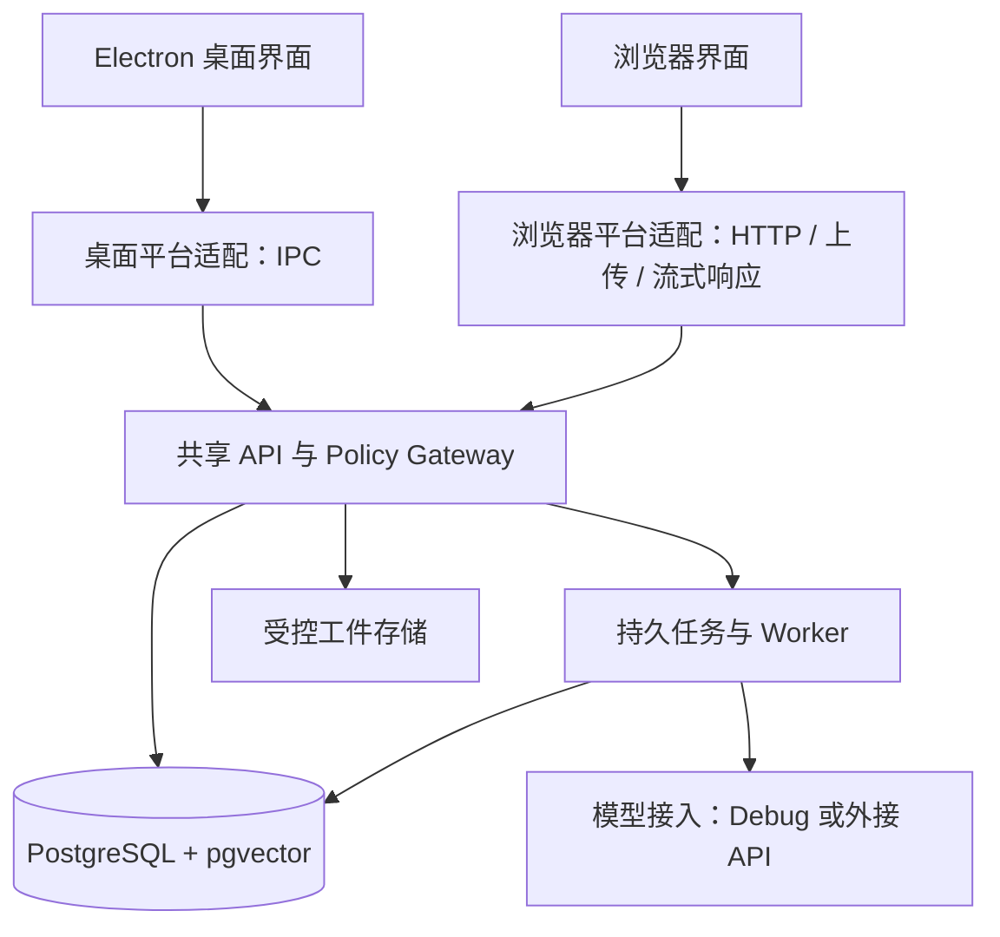

# Audit Network：GitHub 分发、Windows 安装版与网页版发布规划

日期：2026-10-28。性质：发布方案，尚未执行打包、上传、部署或开启新开发阶段。当前 Phase 10 继续按原验收边界推进。

> 2026-10-28 进展：Windows 安装包已在本地构建完成并跑通首次启动，实测数据与踩坑记录见
> `docs/windows-package.md`。本文件第 4/7 节的部分条目（私有 Python 运行时、pgvector 随包、
> 首次初始化流程）已从"待验证"变为"已验证"，仍待解决的是签名、静默安装、端口冲突与在线版。

## 1. 交付目标

让普通用户下载后通过界面完成安装和首次设置，不要求安装 Python、Node.js、PostgreSQL、Git 或 Docker。浏览器与桌面共用业务核心、数据与策略逻辑。

| 交付物 | 使用方式 | 数据与运行环境 | 建议顺序 |
|---|---|---|---|
| Windows x64 安装版 | 下载 Setup.exe，安装后从快捷方式启动 | 应用自带 Python、API、Worker、PostgreSQL 16 + pgvector；数据留本机 | 第一批 |
| 本地浏览器版 | 本地程序启动后点击“在浏览器中打开” | 与安装版使用同一套本机后台、工作区和数据 | 第一批 |
| 在线网页版 | 打开部署好的 HTTPS 地址并登录 | 服务端部署 API、Worker、数据库和工件存储 | 第二批 |
| 管理员自部署包 | 管理员按文档安装到自己的服务器 | 可提供可选 Compose 部署，普通客户端不需要 Docker | 与在线版一起 |
| 便携版 / macOS / Linux | 按平台提供专门构建与验收 | 便携模式的数据位置需明确；跨平台不是改文件后缀 | 后续 |

“打开就能用”的验收包含：环境开箱可用、示例可体验、真实 AI 可配置。安装包不能让没有接口额度的用户凭空获得 AI 服务；用户可自带 Key，也可以未来连接运营方提供的模型网关。

## 2. 仓库现状与缺口

本次核对得到的事实：

- 已配置 GitHub 远程地址 `https://github.com/2131614483/AI-network-auto-audit.git`；尚未在本次验证远程权限和可见性。
- `desktop/package.json` 只有开发、构建、预览、类型检查与测试命令，没有安装包配置。`electron-vite build` 目前不交付可供普通用户安装的完整产品。
- `scripts/start-desktop.ps1` 依赖 Node/npm；`scripts/start-brain.ps1` 依赖项目 `.venv` 和预装数据库，仍使用本机开发默认凭据。
- 核心依赖 PostgreSQL、pgvector、RLS、数据库迁移以及本地工件。只分发 Electron 渲染文件不足以运行。
- `packages/plugin_runtime/runner.py` 使用 `sys.executable -I -c ...` 启动隔离插件子进程。若直接把后端冻成一个 exe，`sys.executable` 的含义会变化，这条链必须专门适配和测试。
- 完整工作台在 `desktop/src`，依赖 `window.auditControl`。`web/app.js` 是已有简化浏览器壳，不能视为与桌面等价的网页版。
- 当前 API 读取客户端租户头建立上下文；本次未发现可供公网直接部署的完整登录、身份到租户映射。RLS 与 Policy Gateway 不能替代用户身份认证。
- `.github/workflows/quality.yml` 已有测试流程，但没有 Windows 发行构建、全新机器安装验证和 Release 产物发布流程。
- 根目录本次未找到 LICENSE。当前已跟踪文件约 95.6 MiB，没有单个超过 10 MiB 的已跟踪文件；发布仍需审查实际纳入的代码、案例、资料与许可，不能将工作区所有内容一起提交。
- Phase 10 尚未整体验收；本轮原生 Electron 窗口走查此前被工具策略阻止。不能用源码测试通过代替发行安装包验收。

## 3. 一套核心、两类部署

这里的共享是代码和契约共享。本地部署与服务器部署使用各自的数据存储，不自动同步审计资料。若要桌面连接服务器，必须显式选择服务器工作区并使用相同的身份认证。

第一步抽取 `PlatformAdapter`：普通请求、流式结果、文件/文件夹上传、下载、窗口控制和日志。桌面实现继续走受控 IPC，浏览器实现走受认证 API。窗口按钮等桌面能力按平台展示，业务页面不复制维护。API 仍独立验证请求和执行策略，不能依赖前端隐藏按钮来授权。

## 4. Windows 安装版

### 4.1 包含什么

建议采用 electron-builder 的 NSIS 安装目标，首发 Windows x64：

- Electron 主程序与共享工作台；
- 私有 CPython 运行环境及构建时锁定、预装的业务依赖；
- API、Worker、受控插件运行器；
- PostgreSQL 16 与匹配版本的 pgvector 二进制及所需扩展；
- 迁移文件、JSON Schema、内置插件、清单及必要静态资源；
- 最小初始化数据与明确标记的合成体验项目。

优先验证私有 Python 运行时方案，保留真正的 `python.exe -I -c` 语义。依赖在构建机准备好，用户电脑不运行 pip/npm。若改用 PyInstaller，先完成专用插件子进程入口与冻结资源适配，不能直接复用现有 `sys.executable` 调用。

大型模型权重、MinerU 等重型可选工具不放进首发基础安装包；在功能界面展示已安装/待安装状态，未来提供独立扩展包。pgvector 的 Windows 构建和再分发兼容性需要先做一次小规模技术验证。

### 4.2 启动和数据

- 程序资源只读；数据、配置、日志、数据库分别放在用户数据目录，并允许通过界面选择工作区。
- 抽离当前依赖仓库位置的路径解析，区分资源根目录与可写数据目录；契约和内置插件也必须能从安装包资源位置加载。
- 启动器统一管理本机数据库、API 和 Worker：端口选择、就绪检测、单实例、错误展示、进程归属和退出清理。
- 默认仅监听 loopback；本地浏览器也需要会话令牌及来源校验。
- 第一次通过“初始化工作区”明确操作创建数据库、扩展和角色并执行迁移，给出结果。普通应用启动只检查版本，不自动升级数据库。
- 每台安装生成独立凭据；应用账号不持有 BYPASSRLS 或迁移权限。迁移账号只在明确的安装/升级操作中使用。
- 关闭窗口可按设置收进托盘继续处理任务；明确“退出”时停止自己管理的后台进程并正常关闭数据库。保留任务 checkpoint。
- 软件更新不覆盖业务资料。数据库变更先备份，再显式迁移；应用回退必须检查 schema 兼容，不能只把 exe 换回旧版。

### 4.3 首次体验

安装 → 选择数据目录 → 初始化工作区 → 查看合成示例 / 连接模型 → 测试接口 → 进入工作台。

保留两种模型模式：Debug 进入高级调试入口，继续限制独立测试库与合成资料，明确需要当前 Codex 会话逐次回填；普通使用者通过向导选择外接 API 并保存自己的配置。示例可离线浏览，不伪装成现场 AI 生成的结果。若提供免费在线体验，必须另行建设服务端额度管理，不能把运营方 Key 塞入安装包。

桌面端密钥从项目 `.env` 编辑转为当前用户的安全存储；日志和诊断包不导出密钥。安装包与下载网页要说清楚资料存放本机，以及哪些调用会发给用户选择的模型提供方。

## 5. 网页版

### 本地浏览器版

复用共享 React 工作台，提供独立浏览器构建入口。安装版启动同源页面和本机 API，从菜单打开浏览器。文件选择改为浏览器上传；流式评审、下载、会话查看和错误提示与桌面一致。本地文件路径不能直接替代浏览器上传的工件引用。

### 在线部署版

建议先做邀请制小范围体验，再开放注册。上线前补齐：

1. 登录、会话、安全退出和角色；租户由服务端根据已验证身份确定，不能相信用户自行提交的租户 ID。
2. 上传和工件存储按工作区隔离；本地磁盘绝对路径不作为远程输入。下载也检查归属和权限。
3. API、Worker、数据库和存储的部署配置；同源 HTTPS 反向代理，数据库不直接暴露公网。
4. 模型配置从全进程共享 `.env` 转为有权限边界的工作区/服务端配置；密钥不回传浏览器。
5. 超时、文件大小、任务并发、模型调用额度，以及备份和恢复验证。部署包不使用开发默认密码。
6. 无登录、越租户、重复写入、断线重连、后台任务重启等验收。继续复用已有 Policy Gateway 和证据链。

GitHub Pages 用于介绍页、文档、截图、演示说明与下载入口。它是静态托管服务，不能单独承载本项目的 Python API、Worker 和 PostgreSQL。完整在线版需要实际运行这些组件的服务器；自部署用户可选 Compose，Windows 普通用户无需安装 Docker。

## 6. GitHub 发布内容

源码仓库保留可构建源码、锁文件、契约、迁移、内置插件、自动化检查和最小合成数据。真实业务资料、私有知识库、用户工件、数据库目录、Key 和当前机器环境不进入发行包。根据明确的发行清单打包；历史材料不删除、不因发布而批量覆盖。

先确认代码与资料的发布权限，确定 LICENSE，并为随包 Python、PostgreSQL、pgvector、Electron 及依赖生成第三方声明。正式公开前核对所选依赖版本的支持状态、代码签名方案和构建来源。

建议首个预览版名称 `v0.1.0-preview.1`，最终版本号以发布时仓库状态为准。拟提供：

| Release 附件 | 用途 |
|---|---|
| `AuditNetwork-<version>-win-x64-Setup.exe` | 推荐下载，包含运行时的安装版 |
| `AuditNetwork-<version>-web.zip` | 浏览器静态构建，供部署；不宣称单独解压即可提供后端 |
| `AuditNetwork-<version>-server.zip` | 服务部署说明、固定版本配置与可选 Compose |
| `SHA256SUMS`、构建清单、依赖清单、第三方许可 | 完整性与发行追溯 |
| 中文发布说明与已知限制 | 安装、首次配置、升级、卸载与功能边界 |

便携包只有在启动、数据位置和保留数据升级验证通过后才加入附件。自动更新放在更新与数据库兼容机制验证之后，不作为首个预览版的前置条件。

CI 分开设置：源码质量门、Windows 构建、全新环境安装测试、Linux 服务部署测试、待审 Release 草稿。产物必须能关联 tag/commit、资源清单与摘要。签名凭据只在受控发布环境使用；正式上传和公开发布安排在产物可审查之后。

## 7. 实施顺序及验收

| 批次 | 主要交付 | 通过标准 | 初步工作量 |
|---|---|---|---|
| A：发布基线 | 明确 Phase 10 验收状态、资源/依赖清单、配置与路径契约、最小初始化数据 | 干净 checkout 可重复构建；测试不依赖作者的本机目录/业务资料 | 1–2 个工作日，另计 Phase 10 未完成项 |
| B：Windows 预览 | 私有 Python 与数据库技术验证、安装包、初始化向导、后台启动器 | 无 Python/Node/PostgreSQL/Docker 的新 Windows 虚拟机，安装后进入工作台；插件子进程与合成资料链路可运行 | 4–7 个工作日 |
| C：本地浏览器 | 共享前端、平台适配层、上传/下载/流式与本机认证 | 同一个本地工作区在桌面和浏览器可用；后端授权一致 | 2–4 个工作日，可与 B 的部分工作交叉 |
| D：在线小范围体验 | 登录、租户、存储、配置隔离、服务器部署包 | 异地浏览器登录可用；越权被拒；重启和备份恢复通过 | 5–8 个工作日 |
| E：GitHub 正式预览发行 | 下载页、安装文档、CI 产物、Release 草稿与签名/许可说明 | 第三方按文档下载并独立完成安装或部署 | 1–2 个工作日 |

这是单人实施的初步排期，约 3–5 周；不含现有 Phase 10 剩余验收、重型外部工具适配、签名资质办理和额外平台。技术验证后重新估算。首批目标先收敛到 Windows 安装版与本地浏览器版，约 1–2 周级别的工作量；不承诺未验证的安装包体积或无系统提示。

发布验收还要覆盖：中文/空格目录、普通用户权限、端口占用、第二次启动、断网、未设置 Key、Key 无额度、Worker 崩溃恢复、升级后数据保留、卸载保留资料。Phase 10 新方案仍只产出 plan_only；发布工作不顺带开放自动执行。

## 8. 本次核对的官方资料

- [Electron 应用打包](https://www.electronjs.org/docs/latest/tutorial/tutorial-packaging)：区分构建、打包与发行。
- [electron-builder 官方说明](https://github.com/electron-userland/electron-builder)：提供 Windows NSIS、portable 目标，以及 GitHub Releases 产物分发能力。
- [Python Windows 嵌入式运行环境](https://docs.python.org/3/using/windows.html#the-embeddable-package)：可随应用分发，第三方依赖由应用构建/安装流程配齐，不能假设用户端有普通 pip 环境。
- [pgvector 官方 Windows 构建说明](https://github.com/pgvector/pgvector#windows)：Windows 扩展需要与 PostgreSQL 环境匹配并单独验证。
- [GitHub Pages](https://docs.github.com/en/pages/getting-started-with-github-pages/about-github-pages)：静态站点托管。
- [GitHub Releases](https://docs.github.com/en/repositories/releasing-projects-on-github/about-releases)：基于版本标签分发可下载二进制与发布说明。

官方网页本次通过直接 HTTP 读取核对；搜索工具限流未作为事实来源。本规划没有执行软件安装、仓库推送或服务器部署。
