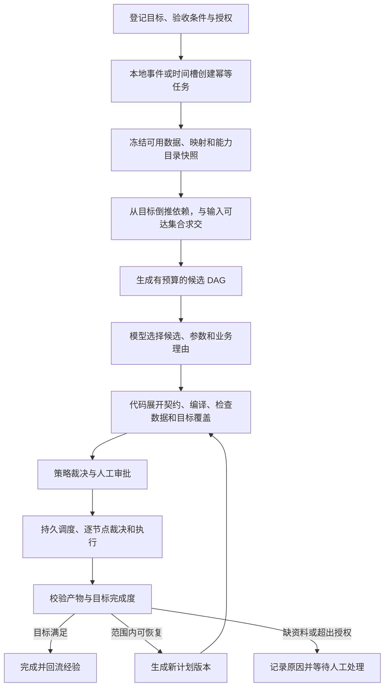

# 后台自主组网：现状评估与实施方案

日期：2026-10-27。依据：当前工作区代码，基线提交 `c96bbf9`，本轮离线检查。

后续修复记录（2026-10-27）：本文基线中 §3.1 的节点策略覆盖、§3.3 的搜索超限与编译扩大显式预算已修复，相关行为约束和回归测试已补齐；169 项针对性测试通过，含独立 PostgreSQL 测试库的拒绝与 attempt 终结验证。详见 `docs/status.md` 当日记录。下文保留评估时的缺陷证据；任务级幂等、Policy 决策持久化引用与后台自主运行闭环仍未在此次修复中实现。

用户后续补充要求已在 `docs/多源证据驱动的多Agent组网闭环-设计与验收-20261027.md` 细化：规划过程反复查询插件关系图、历史成功/失败案例和知识库正文，采用检索、规划、独立评估的多 Agent 协作闭环。该文是后续实现设计，不代表流程已经接线。

本文是设计提案，不代表新阶段已经启动或验收。现行 `AGENTS.md` 仍以 Phase 9 的本机模拟 AIOps 治理为边界；后续实现须先明确新的阶段范围。本文不授予外部网络、生产修复、真实交易或任意命令权限。

## 1. 结论

项目已有“组网组件”，尚未形成“后台自主完成目标”的统一运行链路。

目前有三条相互分离的路径：

1. **人工 AI 规划**：画布聊天/API → `AiPlanner` → 草稿校验与编译，得到候选计划。
2. **确定性组合**：`compose_flow` 根据显式选择或关键词选择能力，再按业务契约、语义别名和阶段规则连线；`build_dag` 则从给定入口向前计算可达节点。
3. **后台定时运行**：Worker → `networking_trigger` → 固定的两节点计划 → `start_plan_run` 同步执行。

真正需要补的是：**目标和授权持久化 → 输入就绪判断 → 按目标选择子图 → 计划版本与审批 → 持久调度 → 结果验收 → 有界重规划**。

后台自主必须有明确起点：用户先登记目标、数据范围、验收条件和授权范围；之后系统在该范围内工作。系统不能自行发明业务目标、补造缺失资料或扩大授权。

## 2. 当前能力与断点

| 环节 | 当前代码事实 | 对后台自主组网的影响 |
|---|---|---|
| 后台触发 | `apps/worker/local.py:168` 读取 `AUDIT_NETWORK_AUTO_NETWORKING`，缺省为关；触发声明仅列数据集、映射、周期和阈值 | 具备定时入口，但没有持久化业务目标与完成条件 |
| 自动规划 | `packages/ops/networking_trigger.py:128` 的 `ledger_plan` 固定生成 `audit.ledger.validate → quant.experiment.evaluate` | 开启开关只能定期重复固定流程，不能根据资料和目标换网 |
| 模型职责 | `packages/ai_planner/planner.py:78` 起的提示词要求模型完整复制端口、schema 和摘要；校验通过后编译 | 已有可靠结构校验，但模型承担了可以由代码完成的契约展开工作 |
| 确定性图搜索 | `packages/ai_planner/path_search.py:85` 的 `build_dag` 只接受目录、入口和节点数上限，没有目标参数；当前应用与 Worker 未接入它 | 可以做可达性分析，不能直接充当按业务目标规划的后台规划器 |
| 目录口径 | `apps/api/main.py:3201` 合并旧 DB 蓝图目录和域插件目录，旧式端口与业务契约端口并存 | 自动规划前需要统一解析和版本锁；兼容旧草稿不能靠静默改名 |
| 输入接入 | `input_mapping`、`input_shapes` 已支持声明映射、分区和部分 CSV/Markdown 形状 | 可以复用，但尚无统一、按数据集版本组织的可用输入快照 |
| 运行调度 | `start_plan_run` 同步调用 `PortBoundExecutor.execute`；后者按拓扑顺序逐节点运行 | 节点有账本，不等于整张计划已经成为可恢复的后台工作流 |
| 另一套调度 | `control.scheduler` 有 Mission/Workflow/Task/Agent；Worker 默认只登记 `scheduler.a/b/c` 三个演示 handler | 现有持久调度器与真实插件 DAG 执行尚需适配接通 |
| 崩溃恢复 | `dag_persistence.py:337` 的 `recover_and_retry_once` 将过期 attempt 标为失败，返回 `retried=0` | 保证不会永远显示 running，但不会自动重建输入、续跑剩余 DAG |
| 质量门 | `networking_quality.assess_plan` 在案例脚本使用，未进入统一执行入口或后台触发；包含“每增加节点至少 8 行”的案例经验规则 | 不能保证后台计划满足业务目标，也不能把该案例阈值推广到所有插件 |
| 经验回流 | 已有运行投影与候选排序先验，代码默认关；画布路径注入先验 | 可以帮助排序，尚不能据此认定后台规划、执行和纠错闭环已接通 |

特别需要区分：固定链中的 `candidates-to-backtest` 适配器明确生成模拟回测，指标和收益序列是固定值（`packages/plugin_topology/port_adapters.py:30`）。它可以验证数据传递和血缘，不能用作“自主完成审计业务”的验收目标。

## 3. 自动执行前的阻断项

### 3.1 节点策略不能在执行时自行放行

`PortBoundExecutor._run_one` 在 `ports_executor.py:558` 创建 `PolicyEngine(allow=[node.capability])`，再将它传给运行时。构造执行器时传入的 `self.policy` 没有用于这次节点裁决。

本轮用无输入、无输出的合成节点和假运行时进行内存探针：调用方策略对 `probe.cap` 返回 `deny`；运行时实际收到的策略返回 `allow`；该合成节点返回 `succeeded`。没有运行真实插件，也没有触达基础设施。该探针证明的是**策略传递缺陷**，不是生产越权演练。

整改要求：后台节点调用必须读取当前租户有效策略，先持久记录 Policy Gateway 决策，再调用插件。`DENY`/`FREEZE` 不执行；`REQUIRE_APPROVAL` 持久挂起；只有 `ALLOW` 可以运行。复用 `packages/policy/gateway.py::record_decision`，不能用 `policy_ref="policy_allowed"` 字符串代替真实裁决记录。策略撤销后，后续节点必须重新裁决。

### 3.2 需要任务级幂等，不能只靠节点 attempt 幂等

触发器将上次时间写入 `.data/networking-triggers-state.json`；没有数据库领取租约。两个 Worker 可以同时判定到期；状态写入失败后还可能再次触发。不同分区发生异常时，已完成分区也缺少稳定的去重身份。

`start_plan_run` 每次生成新的 `run_id`，节点调用键包含该随机值。已有 attempt 防重不能据此保证“同一业务触发只建一个运行”。触发计划名还包含时间戳；本轮核对相同结构、不同计划名会得到不同 `execution_hash`。

建议定义两层身份：

- **业务任务键**：租户 + Mission 版本 + 触发事件/计划时间槽 + 输入快照版本。数据库唯一约束保证同一事件只创建一个任务；同样内容在不同合法周期可以创建新任务。
- **执行调用键**：任务 ID + 计划版本 + 节点实例 + 已确认输入摘要 + 操作版本。重试保留逻辑调用身份，attempt 序号用于记录不同尝试。

输入内容摘要用于合并重复文件事件，但不应无条件抹去用户明确要求的周期重跑。幂等键相同但请求摘要不同必须报冲突。

### 3.3 预算必须由系统约束

本轮合成 5 个均可由同一入口启动的插件，调用 `build_dag(..., max_nodes=2)`，实际返回 **5 个节点**。外层 `while` 检查上限，但内层 `for` 没有在加入节点时再次限制。

另一个设计问题是 `plan_from_dag` 按实际节点数扩大编译预算，不能把它作为用户预算的权威来源。规划器可以报告“预算不足”，不能自行扩大预算。模型草稿中的预算也必须受服务端授权预算约束。

## 4. 数据实际能支撑多大的网

本轮离线扫描得到：所有域共 **123 份插件协议**；运行时代码允许列表有 **123 个 ID**；协议声明 `lifecycle=verified` 的有 **100 个**。这三者口径不同，不能直接等同于当前租户可调用、输入齐全且业务验收通过的插件数。

协议目录有 **64 个外部入口端口**（被消费但无人产出），`input-shapes.json` 已声明 **5 个**，另 **59 个**有缺口分类：

| 分类 | 个数 | 处理方式 |
|---|---:|---|
| `source_gap` | 21 | 缺真实源资料，返回缺什么资料 |
| `shape_gap` | 12 | 需要补形状表达；还须检查源资料是否存在 |
| `out_of_domain` | 8 | 当前数据集没有该域数据，不默认跨域取数 |
| `not_a_payload` | 6 | 应绑定工件引用，而非制造 JSON 正文 |
| `mapped_elsewhere` | 5 | 接入已有 CSV 映射层，避免重复建设 |
| `contract_shape` | 4 | 优先由合法上游产出，不作为随意注入入口 |
| `ops_input` | 3 | 需要明确运营指令，不能从资料猜测 |

只把 5 个已声明形状的端口名作为种子，对审计域 107 个插件运行可达性分析，得到 **6 个候选节点、1 条节点间数据边**：抽样选择 → 样本量计算，其余为入口直接驱动的节点。

这只是**端口名可达性上界探针**：未合并另行管理的 CSV 映射、未检查某一数据集文件、未编译执行、未查询租户策略。因此它不代表“真实只能跑 6 个”，但足以说明不能用插件总数推断自动组网能力。

应先选择资料齐备、输出可复核的目标。需要一个节点的任务就用一个节点；更多节点和更长链不能作为规划质量的主要指标。

## 5. 建议的运行结构



前端退出后，任务应继续保存在数据库中。前端负责提交目标、展示缺口和审批；不能承担调度状态或授权真相。

### 5.1 模型只输出业务选择，代码负责契约展开

建议增加与旧草稿兼容的新规划输入：模型输出受限的 `goal_ref`、`candidate_id`、节点/边引用、白名单参数及选择理由。输入输出契约、版本、摘要、插件绑定由服务端从冻结目录填充。

不能让模型发明候选、别名、转换器、路径或权限。参数来自已发布参数契约；端口转换只能选已登记且语义适用的适配器。模板作为有来源的候选可以保留，但模型失败后采用模板必须保留失败原因，并单独评价模板是否达成目标。

### 5.2 规划应同时看目标和已有数据

建议算法：

1. 先按租户授权、业务域、已验证绑定和目录版本收敛候选；未批准跨域能力不进入候选。
2. 把目标解析为明确的产物契约与验收器，例如抽样方案、样本量，而非仅有一句自然语言。
3. 从目标向后展开生产者；一个节点的所有必填输入是 **AND** 依赖，同一业务产物的多个生产者是 **OR** 备选。
4. 用真实可用工件向前计算可达性；剔除输入不齐、契约不兼容或权限不足的路径。缺资料进入 `blocked_input`，不能自动填合成值。
5. 先满足目标，再按运行风险、成本、时延、历史成功率排序，保留受预算限制的少量候选；优先最小充分子图。
6. 模型选择候选并解释取舍；代码核实选择、展开权威契约，再交编译器和数据前置检查。

数据绑定除契约兼容外，还要核对项目、期间、粒度、单位、分类、数据集及映射版本。相同端口名不保证业务语义相同。可选输入、`many` 聚合、多实例复用与显式适配器必须沿用已有契约，不能在新的搜索器里简化丢失。

## 6. 应先约定的契约与状态

不再另建平行的能力目录。复用插件协议、语义目录、参数契约、工作流和 ArtifactRef；以下是需要补齐或扩展的语义，具体表结构在契约评审后确定。

| 对象 | 必要内容 |
|---|---|
| Mission/目标版本 | 租户、目标产物、验收器版本、项目/期间、数据范围、预算、停止条件 |
| 授权范围 | 显式 capability 集合、数据集范围、允许参数/副作用、有效期、审批与 ChangeRequest 引用 |
| 输入快照 | ArtifactRef 与 SHA256、数据集/映射版本、契约、期间/单位、质量概况、缺失项 |
| 后台组网任务 | 业务幂等键、请求摘要、trace_id、状态、重试时间、领取租约、fencing token |
| 计划版本 | 目录及绑定锁、参数和输入绑定、execution_hash、前一版本、变更理由、审批裁决 |
| 运行结果 | 任务/计划/节点 attempt、真实 Policy 决策引用、输入输出摘要、验收结论、缺口与失败分类 |

建议后台状态：`queued → profiling → planning → validating → pending_approval/ready → running → verifying → succeeded`。另有 `blocked_input`、`blocked_capability`、`retry_wait`、`failed`、`cancelled`。每次状态变化保留历史和 Trace，不能只写一条日志。

审批必须绑定计划、输入和参数摘要；摘要变化不得继续使用旧审批。范围内的后台权限也应是显式、限期、可撤销的授权，执行前仍要做当前策略裁决，不能开启泛化 AUTO。

### 持久调度的接线方式

优先复用现有 PostgreSQL + Outbox/Inbox + `control.scheduler`，为真实插件任务增加受控 handler。需要先验证它与 `node_attempts` 的状态映射，明确唯一调度权威；不要让两套引擎同时认为自己拥有同一节点。

将当前“整个 DAG 同步跑完”拆成“持久领取一个就绪节点 → 事务外执行 → 持久结果 → 解锁下游”。规划、长耗时插件和富媒体工作使用独立队列/工作者职责，避免当前串行循环中一项耗时任务阻塞心跳、事件分发及其他任务。第一版不要求并发执行，也不需要先引入新的中间件。

恢复时必须能重载冻结计划、校验已经完成的产物摘要、恢复输入绑定，并以租约和 fencing 拒绝旧 Worker 写回。只有持久 attempt 账本不够。具有副作用的操作不能假定可恰好执行一次，必须由插件幂等语义或人工对账闭合。

## 7. 有界重规划，而非无限重试

- **临时执行错误**：契约允许时对同一逻辑调用做有次数/退避上限的重试。
- **缺资料或映射歧义**：挂起并返回结构化缺口；不能靠重试或换模型制造资料。
- **能力不可用**：寻找契约和业务语义均兼容、且在授权内的替代实现；形成新计划版本并重做裁决。
- **输出不达标**：按版本化业务验收器产生原因，再规划尚未完成的子图；结构编译通过不等于业务完成。
- **超过重规划次数、时间、成本或权限边界**：停止并保留人工处理入口。

已完成且输入/版本一致的节点可以复用产物；输入、实现或参数变化时，需要重新判断复用有效性。旧计划和旧证据保持可查。

## 8. 推荐实施顺序与首期范围

**建议的第一个新阶段：本机模拟数据上的后台自主规划，结果停在人工审批入口。** 新增自动执行与运行中重规划分别留待后续明确的阶段；每次只实现和验收一个阶段。

首期按下列顺序推进：

1. **先写契约和失败测试**：目标、输入快照、计划选择、预算、幂等、租约、挂起原因、审批绑定。将本轮策略传递与预算越界探针固化成回归测试，先纠正已有行为。
2. **再做数据库任务与输入快照**：显式迁移、RLS、事务 Outbox、稳定触发身份；映射和形状按数据集版本引用，明确旧端口兼容方式。
3. **接通目标导向的确定性候选规划**：保留现有编译器，模型采用受限选择输出；无模型时可生成确定性候选并如实标注来源。
4. **接入独立后台规划工作者与只读工作台投影**：离开画布仍能得到可复核候选或缺口；本阶段不消费新计划执行授权。
5. **验收首期并更新 `docs/status.md`**：所有相关测试通过才标记完成；工具缺失、未测路径和阶段外功能如实记录。

本阶段测试只用独立测试数据库和合成数据，不调用云端模型，不读写生产基础设施。先用两类资料齐备的目标证明“会选择”：库存盘点差异结果，以及抽样计划与样本量。它们用于验证范围内的选网与缺口报告，不代表完整财报审计已经实现。

后续阶段再接“审批后的持久执行与恢复”；该阶段通过后，另行建设“按验收结果有界重规划”。先把一条链可靠地交给后台，才能评价运行中换网的收益。

## 9. 验收必须覆盖什么

| 场景 | 期望行为 |
|---|---|
| 相同目标，输入可用性不同 | 计划按证据改变；缺必要输入时挂起，不补造种子 |
| 相同资料，目标不同 | 选择不同的必要子图；不会执行全部可达插件 |
| 两个 Worker 消费同一事件 | 一个业务任务，领取租约互斥，重复消息可安全回读 |
| Worker 在规划中崩溃 | 重启后恢复同一任务，不依赖页面或内存线程 |
| 输入/参数变化 | 产生新快照/计划版本；旧审批不能复用 |
| DENY、FREEZE、审批中或跨租户 | 无插件执行，保留真实拒绝或挂起记录 |
| 预算不足 | 返回明确缺口，不扩大节点数、成本或时间预算 |
| 无模型、目录故障、缺适配器 | 返回可诊断状态，来源和回退原因可查 |
| 多输入扇入、聚合端口、多个同类节点 | 输入绑定明确、语义兼容、不会串错工件 |
| 后续执行/重规划阶段 | 崩溃续跑、租约 fencing、策略撤销、重规划上限和产物复用另做验收 |

衡量指标应为目标覆盖率、输入就绪率、业务验收通过率、任务去重正确性、恢复成功率、人工介入率和运行成本。原始资料为合成时必须标识；链更长、节点更多和 `run=succeeded` 均不能单独证明自主业务能力。

## 10. 本轮验证与限制

使用项目虚拟环境 Python 3.12.12，以下 **100 项离线单测通过，耗时 4.74 秒**：

```powershell
.\.venv\Scripts\python.exe -m pytest -q --confcutdir=tests/unit `
  tests/unit/test_networking_trigger.py tests/unit/test_networking_quality.py `
  tests/unit/test_path_search.py tests/unit/test_input_mapping.py `
  tests/unit/test_input_shapes.py tests/unit/test_ai_planner_experience_prior.py `
  tests/unit/test_composer_wiring.py tests/unit/test_composer_instances.py
```

`--confcutdir=tests/unit` 有意不加载根 `conftest.py` 的测试数据库基线调整；本轮没有运行数据库集成测试。补充内存探针分别检查了策略对象传递、节点预算和真实目录端口可达性，结果见前文。

本轮仅新增本文；未更改服务逻辑、策略、数据库、运行开关或阶段状态。没有执行全量 pytest、ruff、mypy、前端 typecheck、实际后台运行或长时间稳定性验收，因此不能据本报告宣称后台自主组网已经实现。运行中的进程、有效环境开关与数据库现状也未做现场核验。
