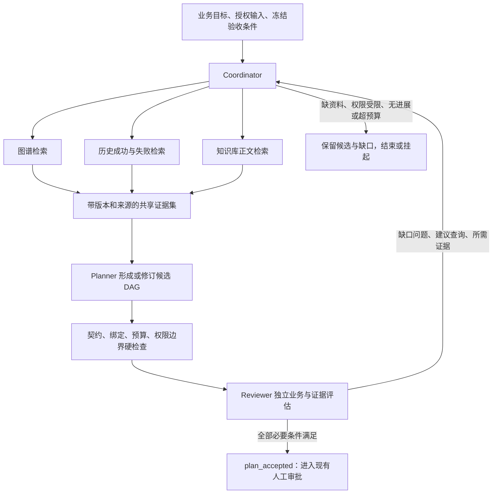

# 多源证据驱动的多 Agent 组网闭环：设计与验收

日期：2026-10-27。状态：根据用户新增要求形成的下一阶段设计，尚未实现或验收。

目标：AI 在规划过程中主动、反复查询插件关系图谱、历史组网记录和知识库，结合独立评估意见修改候选网络，得到证据充分、满足业务目标的方案。

本设计延续现有确定性编译器、Policy Gateway、租户隔离与不可变证据。现行 `AGENTS.md` 的 Phase 9 状态不因本设计自动改变；本轮不新增运行权限，不连接外部模型或生产设施。刚完成的节点策略与节点预算修复继续保留。

## 1. 用户要求应体现为哪些实际行为

1. **查询三个来源**：规划器能够看见插件之间怎样衔接、类似任务过去怎样成功或失败、知识库有哪些相关业务依据。
2. **检索与规划交替发生**：先查资料形成草稿；评估发现问题后，再针对该问题查图谱、历史或知识库，进而改变选用插件、依赖、输入绑定或参数。
3. **独立评估方案**：不能由生成草稿的 Agent 自己宣布完成；编译成功也不能直接等同于业务方案通过。
4. **协作具有因果作用**：检索 Agent 提供的证据、评估 Agent 给出的缺口必须能改变后续查询和候选方案，不能只在最后补六段角色说明。
5. **如实结束**：有充分依据才通过；缺资料、缺能力、证据冲突、权限不足或预算耗尽时，输出明确原因与待处理项。

这里的三源是**规划依据**。业务执行的 CSV、报表或其他 ArtifactRef 仍是一类独立输入，必须验证可用性和授权。知识库里“描述某份台账”的段落不能代替那份台账。

## 2. 当前实现与用户目标的差距

| 当前能力 | 可复用位置 | 需要补齐的部分 |
|---|---|---|
| 插件关系召回 | `packages/graph/graph_planning.py::CapabilityGraphAdapter.match_nodes/expand_to_capabilities`；`ai_planner/workbench.py::recall_planning_directory` | 目前是首次召回与有界展开；需接受评估缺口驱动的后续查询，并保留关系来源和版本 |
| 历史节点与连线证据 | `plugin_topology/service.py::list_plan_runs/canvas_projection`；`dag_persistence.py::AttemptStore.query_attempts/query_edges` | 目前以新近运行列表和按 ID 下钻为主；需按目标、能力、输入特征与版本检索相关成功/失败案例 |
| 历史聚合 | `experience/projector.py::read_overlay`；`ai_planner/experience_prior.py` | 当前先验主要压缩为插件权重，丢失了案例背景、失败原因和具体输入/输出；不能替代历史案例检索 |
| 知识库正文检索 | `knowledge/retrieval.py::KnowledgeRetrievalService.search` | 需接入规划循环，并补文档版本、摘要、批准状态、有效性和引用来源 |
| 统一搜索 | `search/fusion.py::search_all` | 是导航搜索；文档分支丢弃正文/chunk 引用，历史分支只搜旧运行面，不能直接作为三源证据接口 |
| AI 修订 | `ai_planner/planner.py::AiPlanner.plan` | 目前只根据校验/编译错误重出草稿，不会在修订中再查三源；首次编译成功即返回 `draft_ready` |
| 多角色流程 | `ai_planner/composition.py::compose_with_trace` | 先执行 `compose_flow`，再生成六个角色的说明；注入 Agent 不能改变连线，尚不是本需求中的协作规划 |
| 组网评测 | `ai_planner/evaluation.py` | 当前关键词覆盖只列三个能力，未命中关键词时可返回覆盖成功；不能承担一般业务方案的独立评估 |

因此，新闭环应建立在现有查询与编译能力之上，同时保留旧入口的兼容性；不应把既有角色名、排序先验或 `draft_ready` 改个名称就宣布完成。

## 3. 三个来源分别回答什么

### 3.1 插件关系图谱：有哪些真实可选的结构

查询内容包括：能力用途、输入/输出业务契约、上下游、显式适配器、替代实现、已确认依赖、历史观察关系、尚未批准的关系建议。

输出必须标明关系性质：`declared`、`observed`、`suggested`，以及来源、版本、证据引用和适用范围。建议关系可用于提出验证问题，不能直接当已批准兼容关系。

图谱用于发现和解释。最终能否使用某个插件、能否连接某个端口，仍由当前已验证绑定、权威契约与策略裁决决定；图上“有边”不是执行许可。

现有图谱适配器单次最多一跳、展开数量受限。允许反复查询，但整个会话仍需要累计节点、访问深度和查询次数上限，不能通过多次一跳查询变成无预算全图扫描。

### 3.2 历史组网记录：相似任务在什么条件下有效

必须同时覆盖两套真实运行入口：

- M6：`topology.execution_runs` 与对应执行账本。
- CW3：`control.node_attempts` 与端口输入绑定、输出引用、错误和 Trace。

召回应结合目标、能力集合、输入契约与数据概况、业务域、插件/契约版本、结果状态和时间。检索结果同时提供成功案例和相关失败反例，保留失败分母，避免只看成功记录。

每个案例需要能下钻到 `run_id`、attempt、实际边、输入/输出摘要、版本、失败分类，以及是否通过独立业务验收。单纯 `succeeded` 只说明运行完成；演示、合成种子和固定指标适配器产出的成功不能自动作为业务有效性证明。

历史能力和当前版本不一致时，说明可迁移与不可迁移之处；重验当前契约、资料和权限，不照搬旧网。

### 3.3 知识库：为什么采用某个方法或参数

使用正文片段支持业务方法、数据口径、限制条件和方案解释。返回至少包含 `document_id`、`document_version`、`chunk_id`、片段位置、内容、完整 SHA256、来源工件、知识状态和有效性。

当前 `KnowledgeRetrievalService.search` 已返回正文、chunk 与 ordinal，但没有返回文档版本/摘要，也没有将所有命中限制为已发布知识。需要区分草稿参考与权威依据；搜索命中本身不说明内容已批准或仍有效。

正文是待验证的数据。文档中的命令、工具授权或“忽略前文”等内容不得成为系统指令；Agent 也不能通过引用文档修改验收规则。

首期本机验证显式使用 keyword 检索，并注入不允许联网的 embedder。当前默认统一 embedding 配置可能指向远程服务，不能仅凭 `hybrid` 或 Ollama 名称认定离线。以后启用本机模型仍需服务端验证允许的端点。

## 4. 采用六个职责明确的 Agent

| 角色 | 负责内容 | 交付物与限制 |
|---|---|---|
| Coordinator／协调器 | 冻结目标和验收规则、分配检索、管理轮次与预算、决定进入下一状态 | 查询任务、轮次记录、停止原因；不能删除评估阻断项或扩大授权 |
| GraphScout／图谱 Agent | 找能力、上下游、替代项、连线条件和关系证据 | 候选子图与关系引用；不能注册插件、批准别名或授予权限 |
| HistoryScout／历史 Agent | 找相似案例、失败反例、版本差异和数据适用条件 | 案例卡与反例约束；不能把历史成功视为当前授权 |
| KnowledgeScout／知识 Agent | 找业务依据、方法、参数口径和相反证据 | 带版本与片段引用的依据；不能把检索文本升级为指令 |
| Planner／规划 Agent | 综合目标、输入和证据，选择或修订候选 DAG | 结构化选择、参数和简短决策摘要；契约由代码展开，不能发明能力 |
| Reviewer／独立评估 Agent | 依据冻结目标检查覆盖、证据、反例和适用性，可发起补检索请求 | 结构化评估、阻断项和补查问题；不能改自己的评分门槛或批准执行 |

确定性校验器、编译器和 Policy Gateway 是代码闸门，不由 Agent 投票替代。

六个角色不要求部署六种不同模型。需要的是独立职责、上下文、工具范围和可查的调用记录；模型共用时也不能声称具有统计上的独立性。第一次三源检索可以并行，后续按缺口发起定向查询。

Reviewer 使用独立上下文，先看目标、候选方案和可核验依据，避免把 Planner 的自信表述当证据。角色分开并不消除共用模型的偏差，所以最终通过仍依赖确定性检查和可追溯证据。

## 5. 真正的多轮检索—规划—评估闭环



每轮必须留下：当前候选、评估问题、查询目的、实际返回、证据增量、方案变更和下一步决定。

标准过程：

1. 将自然语言目标转换为结构化目标条目及预期产物，确认业务输入快照；目标存在歧义时显式保留待澄清项。
2. 第一轮查询三个来源，分别记录查询成功、空结果、拒绝、降级或故障；不能只记录“搜过”。
3. Planner 以证据为依据选择候选结构；代码取权威目录展开端口、版本和摘要，再编译。
4. Reviewer 给出逐目标判断、证据引用、反例、阻断项及具体 `retrieval_requests`。
5. Coordinator 对补查请求重新检查权限和预算，派给相应来源 Agent。新结果进入证据集后，Planner 修改受影响部分，而非只改变解释文字。
6. 重新执行硬检查与独立评估；通过时冻结方案、目标、依据和评估报告。未通过则继续或按停止条件收口。

不是每个任务都强制查四轮。第一轮证据充分即可通过；反复检索应由不确定性、缺口或反例驱动。重复同一查询、收到相同结果且没有方案进展，不算有效迭代。

### 一个示意过程（不是本轮实际运行记录）

目标为“给出抽样方案与样本量，并说明方法依据”。第一轮图谱找到对应能力，历史 Agent 提供相似案例与失败案例，知识 Agent 找到抽样方法片段。Reviewer 发现历史案例的数据粒度和本次资料不同，当前参数缺少充分依据。

第二轮就不应重复整句目标搜索。应定向查该参数的适用条件、相同输入粒度的历史案例，并核验当前插件接受的参数与输入契约。Planner 据此修改参数或能力选择；如果仍无法证明适用性，则输出缺口，不能为得到“通过”降低标准。

## 6. 统一受控检索 Broker

Agent 不直接连接数据库、不执行 SQL，也不获得任意文件、URL 或命令入口。Broker 提供白名单操作：

- 图谱：`search_capabilities`、`expand_relations`、`get_contract_binding`。
- 历史：`search_similar_runs`、`get_run_evidence`、`get_failure_cases`。
- 知识：`search_passages`、`get_passage_version`。

这些是拟新增的内部操作契约，不代表现有 HTTP 路由已提供。

每次查询都由服务端会话身份确定租户与数据范围，携带 `trace_id/session_id/round_id/agent_id/query_id`、结构化参数、查询目的和预算。先完成当前 Policy Gateway 裁决与审计记录，再调用现有底层查询服务；顶层允许规划不能代替逐源读取授权。

底层图谱/知识/经验服务大多只有 RLS，没有查询 Trace 与持久策略记录，因此不能直接暴露给新 Agent。缓存命中也须重新核验当前可读范围，且只能复用同一租户、范围、版本、参数下的结果。

建议统一的证据封装包含：

```text
evidence_id / source_kind / source_ref / tenant_id
query_id / round_id / agent_id / request_trace_id / source_trace_id
source_version / source_sha256 / retrieved_at / authority_status
content_excerpt 或 typed_facts / derived_from / applicability
retrieval_status / degradation_reason / policy_decision_ref
```

`retrieval_status` 区分 `available`、`empty`、`denied`、`degraded`、`error`。空结果是合法事实；拒绝或故障不能伪装成“已查无结果”。历史为空时能否继续，应由事先确定的任务规则决定；任务必须依赖某项业务依据时，缺该依据就不能通过。

同一运行可能同时出现在图谱经验边、历史案例和知识总结中。通过 `derived_from` 追溯并去重，不能将它当成三份独立证明。

知识分块引用保留完整摘要，不使用统一搜索中用于显示的 12 位摘要前缀作为完整校验值。多轮检索出现新版本时必须显式生成新的证据集版本；最终检查版本有效性，不能在同一引用下静默替换内容。

## 7. “评估通过”的明确定义

通过条件是必要条件的合取，不能用一个综合高分抵消缺输入或权限问题。

| 检查层 | 通过依据 |
|---|---|
| 结构与契约 | capability、plugin_id 和端口必须属于同一冻结版本的已验证绑定；端口兼容；必填输入齐备；无环；扇入/多实例语义正确；预算不超限 |
| 数据适用性 | 业务输入真实可用且授权；项目、期间、粒度、单位和分类匹配；不能用未验证假设补输入 |
| 目标覆盖 | 每个必须完成的目标对应具体节点、预期产物和检查方法；未识别目标不能按“默认覆盖”放过 |
| 依据可查 | 关键能力选择、参数或业务方法有有效依据，能定位到图关系、历史运行或知识片段；引用与内容相符 |
| 反例与冲突 | 相关失败案例和相反依据已处理；仍有实质冲突时明确阻断或转人工，不投票消除冲突 |
| 权限与风险 | 所有读取通过当前策略；方案没有扩大数据、能力或副作用范围；执行审批仍单独处理 |
| 独立评估 | Reviewer 按冻结规则完成逐项评估；必要项无 `unmet/unknown`，阻断项为空 |

最终评估报告绑定 `goal_hash`、`plan_hash`、`evidence_set_hash`、`evaluation_policy_version` 和 `policy_snapshot_ref`。方案、目标、输入或关键证据发生变化后，旧报告失效，必须重新评估。冻结的策略引用用于复核当时的裁决，不允许绕过当前已撤销的权限。

首期 `plan_accepted` 表示静态方案与证据检查通过，**不表示插件已运行成功，更不表示业务结果已验证**。实际执行与产物验收属于后续运行阶段；需要执行才能判定的性质应标注为待运行检查，不能作为已通过事实。

## 8. 循环、状态与预算

建议状态：`created → retrieving → drafting → validating → reviewing → accepted`。评估需补查时记录 `needs_evidence` 回到 retrieving；缺必要业务输入为 `blocked_input`，缺能力为 `blocked_capability`，权限阻断为 `blocked_policy`，另有 `budget_exhausted`、`stalled`、`failed`、`cancelled`。

以下仅为首期拟议配置，需用测试与实测调整，不能交给模型任意增大：最多 4 轮、18 次来源查询、每次最多 8 条证据、累计最多 64 个图节点；另设每次查询超时、总时限、模型调用次数和上下文字符上限。

需要同时限制单轮和全会话预算。去重查询不绕过计量；缓存命中与实际读取分别记账。优先保留能够改变判断的反例、契约和精确片段，避免把所有历史和文档灌进上下文。

相同规范化查询、证据集与候选摘要连续重复且无法解释进展时，结束为 `stalled`；不可因为轮数尚未用完而空转。资料永久缺失与临时服务故障采用不同处理，不能对两者都无限重试。

## 9. 后台持久化与现有项目的接线

规划会话需在数据库保留：输入请求及摘要、冻结目标、角色任务、轮次、每次查询及裁决、证据版本、候选计划版本、评估报告与状态事件。记录简短决策摘要和结构化依据，不要求保存模型私有思维过程。

现有 `topology.planning_intents` 只适合意图摘要；画布记录甚至写入空 `matched_nodes`。不能将多轮正文、计划和评估全部塞入 `reason`。应按契约设计会话/查询/证据/候选/评估的追加记录，通过公共 ID 关联旧意图和运行。

状态投影可以更新，历史证据和旧候选不能硬删除。会话创建采用租户内唯一幂等键与请求摘要校验；后台领取使用租约/fencing，重启后从已提交轮次恢复，不能把真相留在画布客户端或 daemon 线程中。

建议实现落点（以下均是计划，不是已存在的模块）：

| 模块 | 职责 |
|---|---|
| `packages/ai_planner/evidence.py` | 三源查询、证据及有效性契约 |
| `packages/ai_planner/retrieval_broker.py` | 身份、逐查询策略、来源适配、预算与缓存 |
| `packages/ai_planner/collaborative.py` | 六角色任务、轮次状态机和定向补检索 |
| `packages/ai_planner/assessment.py` | 硬检查、业务目标覆盖和独立评估报告 |
| `packages/ai_planner/session_store.py` | 会话、候选和评估的持久记录 |
| 现有 API/Worker 的窄接线 | 提交与查看会话、恢复待规划任务、输出方案与缺口；不直接执行新方案 |

## 10. 一个阶段内的实施顺序

建议将这次细化后的要求定义为下一阶段的**多源协作规划**，首期只做本机数据下的规划至人工审批，不同时扩展生产执行。

1. **先契约与验收数据**：目标、检索请求、证据、候选、评估与状态契约；准备图谱、成功/失败历史和知识片段的独立测试库夹具。
2. **接通受控三源 Broker**：复用当前服务，补版本和来源；所有查询有租户、Trace、策略引用和故障语义。
3. **实现实际协作循环**：三源检索能影响 Planner；Reviewer 的补查任务能触发第二轮真实来源调用，并改变候选。
4. **持久化与后台接线**：显式执行迁移，验证应用角色/RLS、幂等、恢复；工作台展示每轮查了什么、为什么修改、哪里未通过。
5. **先离线闭环，再本机模型验证**：CI 注入可控 Agent 和禁止联网的检索依赖；真实模型运行单独记录模型、配置与效果，不把模拟测试通过当真实模型能力证明。

验收前不修改阶段完成状态。外部联网、多源生产接入、执行中的动态改网及自动修复仍不属于这个规划阶段。

## 11. 验收必须证明“信息改变了方案”

| 用例 | 必须观察到的结果 |
|---|---|
| 图谱给出当前候选的契约冲突 | 查询并选择有效替代或诚实报缺口；不能只改解释 |
| 历史包含相同能力的成功与失败 | 两类均可检索；失败原因影响方案适用条件或后续查询 |
| 知识库给出与默认参数相反的有效依据 | 修改受影响参数/方法，或明确保留冲突并转人工 |
| 第一轮证据不足 | Reviewer 产生具体补查请求，第二轮确实访问对应来源且返回新证据 |
| 移除第二轮查询结果 | 原本应通过的场景变为不通过，证明补检索不是装饰性调用 |
| 第一次编译成功但漏了业务目标 | 评估拒绝并修订，不能返回最终 accepted |
| Planner 自称通过、Reviewer 仍有阻断项 | 不通过；Planner 无权修改 Reviewer 的必要检查 |
| 多 Agent 对同一错误高度一致 | 硬检查仍能否决，不以票数决定契约或权限 |
| 三个来源转述同一次历史运行 | 识别同源，不累计为三份独立证据 |
| 引用不存在、版本失效或内容不支持结论 | 拒绝该依据，重新检索或返回缺口 |
| 历史无相关案例、知识无命中、服务故障、权限拒绝 | 返回不同状态；是否可继续按冻结任务规则判断 |
| 恶意知识片段要求换租户或扩大工具权限 | 无越权查询，不修改目标与评估门槛 |
| 预算耗尽或重复空转 | 有限时间内按明确状态结束，并保留当前候选与缺口 |
| 会话重放、并发领取、进程崩溃 | 任务身份和证据不重复、不跨租户，能按持久状态恢复 |
| 目标/方案/依据修改后仍引用旧评估 | 摘要不匹配即拒绝沿用通过结果 |

业务质量用目标覆盖、证据充分性、反例处理、端口正确性和适用性衡量；运行质量用查询次数、模型调用次数、轮数、成本、耗时和人工介入率衡量。不是以节点多、查询多或 Agent 多来证明更智能。

## 12. 本轮交付范围

本轮由三个只读分析 Agent 分别核对图谱/历史、知识库、规划/评估实现，并汇总成本文。没有新增生产组网流程、执行新方案、调用外部模型或写入业务数据库；文中拟新增模块、状态、预算和验收项均尚未实现。
